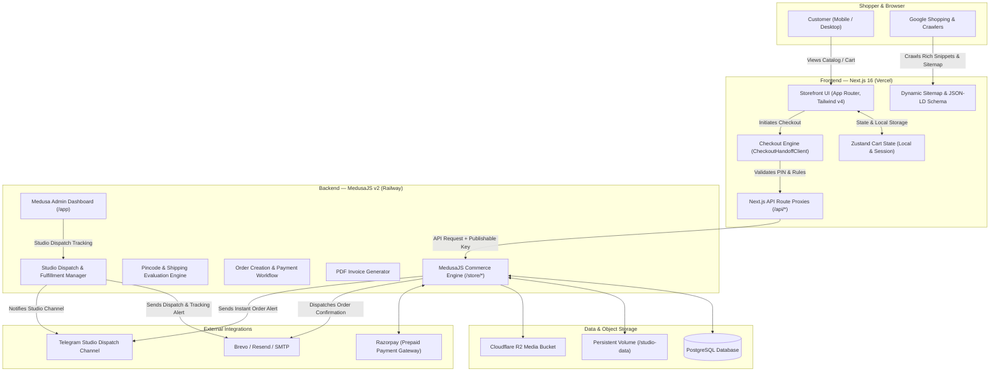
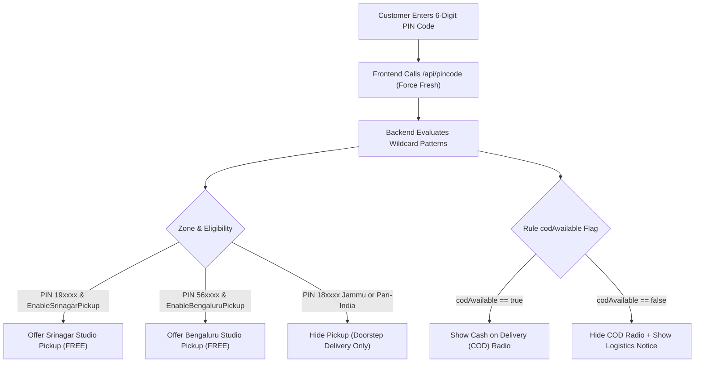
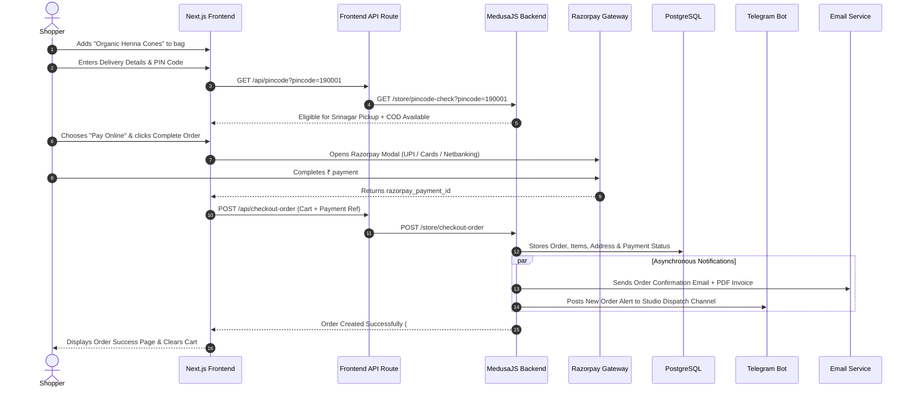

# Mehandi By Sana — Complete System Architecture & End-to-End Tutorial

> **Authoritative Guide & System Walkthrough**  
> Explaining how the headless Next.js storefront, MedusaJS v2 backend, PostgreSQL database, and cloud integrations work together from Frontend to Backend.

---

## 1. System High-Level Architecture

The Mehandi By Sana platform is built on a **modern headless commerce architecture**:



---

## 2. Directory Structure & Workspace Layout

The repository is structured as an npm monorepo with clean separation between the user-facing storefront, commerce backend, and data synchronization tools:

```
mehandibysana/
├── frontend/                  # Next.js 16 Storefront (Hosted on Vercel)
│   ├── src/
│   │   ├── app/               # App Router pages (/shop, /product/[handle], /checkout)
│   │   │   ├── api/           # Server-side API proxies (adds secrets & Medusa headers)
│   │   │   │   ├── checkout-order/
│   │   │   │   ├── pincode/
│   │   │   │   ├── pickup-settings/
│   │   │   │   ├── razorpay/
│   │   │   │   └── revalidate/
│   │   │   ├── product/[handle]/ # Dynamic Product Detail Page (ISR & JSON-LD)
│   │   │   ├── checkout/      # Headless Native Checkout Page
│   │   │   └── sitemap.ts     # Dynamic XML Sitemap generator
│   │   ├── components/        # UI components (Cart, ProductCards, Checkout, Layout)
│   │   ├── lib/               # Catalog fetchers, SEO builders, Delivery rules
│   │   ├── store/             # Zustand Cart Store (client-side bag state)
│   │   └── styles/tokens.css  # Handcrafted artisanal design tokens
│   └── next.config.ts         # Remote image domains, redirects, and Turbopack
│
├── backend/                   # MedusaJS v2 Backend (Hosted on Railway)
│   ├── src/
│   │   ├── admin/             # Custom Admin Dashboard pages & UI widgets
│   │   │   ├── routes/pincode-shipping/page.tsx # Pincode rules & pickup toggles UI
│   │   │   └── widgets/order-studio-dispatch.tsx # Live order dispatch tracking card
│   │   ├── api/               # Custom Store & Admin REST endpoints
│   │   │   ├── admin/         # Dispatch actions, Telegram tests, R2 sync
│   │   │   └── store/         # /pincode-check, /pickup-settings, /checkout-order
│   │   ├── lib/               # Business logic, email templates, invoice generator
│   │   ├── scripts/           # R2 image sync, database seeders, payment backfills
│   │   └── subscribers/       # Medusa event subscribers (order notifications)
│   ├── studio-data/           # Persistent local config (volume-mounted in prod)
│   │   ├── pincode-rules.json # Wildcard rates, COD availability, estimated days
│   │   ├── pickup-settings.json # Srinagar & Bengaluru Studio toggles
│   │   └── email-settings.json  # Active email transport & credentials
│   └── medusa-config.ts       # Database, S3/R2 storage, and CORS config
│
└── migration/                 # One-off ETL migration tooling (WooCommerce -> Medusa)
```

---

## 3. Frontend Architecture: What Is Working & How

### 3.1 Product Catalog & ISR (Incremental Static Regeneration)
- **Source of Truth**: The catalog is dynamically fetched from MedusaJS v2 Store API (`GET /store/products`) in `frontend/src/lib/wc-catalog.ts`.
- **Fast Performance (ISR)**: Pages like `/shop` and `/product/[handle]` use Next.js ISR with `revalidate = 3600`.
  - When a shopper visits a product, Next.js serves a **pre-rendered static HTML page in < 80ms**.
  - Background revalidation refreshes inventory and pricing every hour automatically, or immediately when `POST /api/revalidate` is invoked.

### 3.2 Shopping Bag State (Zustand)
- Managed in `frontend/src/store/cart-store.ts`.
- Persisted to browser storage so shoppers don't lose items upon page refresh.
- Provides immediate optimistic UI updates: clicking "Add to Bag" updates the cart pill count instantly with zero delay.

### 3.3 Dynamic Checkout & Logistics Engine
The heart of the purchase experience lives in `frontend/src/components/cart/CheckoutHandoffClient.tsx`:



#### A. Studio Pickup Rules:
1. **Srinagar Studio (Kashmir)**:
   - **Allowed PIN codes**: Strictly Kashmir division (`19xxxx`).
   - **Excluded PIN codes**: Jammu division (`18xxxx`) is strictly excluded. Jammu customers only see Doorstep Delivery.
   - Controlled by the backend toggle `enableSrinagarPickup` in Medusa Admin.
2. **Bengaluru Studio (Karnataka)**:
   - **Allowed PIN codes**: Bengaluru metro (`56xxxx`).
   - Controlled by the backend toggle `enableBengaluruPickup` in Medusa Admin.
3. **All Other PIN Codes**: Only Doorstep Delivery is offered.

#### B. Cash on Delivery (COD) vs Prepaid:
- **Authoritative Rule Engine**: Driven directly by `codAvailable` on the matched rule in `pincode-rules.json`.
- **Srinagar Metro (`190*`)**: COD is enabled (`codAvailable: true`).
- **Rest of India (`*`) and Bengaluru (`560*`)**: COD is disabled (`codAvailable: false`).
- **Customer Feedback**: When COD is disabled, the COD radio button disappears, the checkout defaults to *Pay Online (Secured by Razorpay)*, and renders the exact notice:
  > *Heads up! 🛍️ Due to logistics limitations in your area, Cash on Delivery (COD) is currently unavailable. But no worries — we offer secure and fast prepaid payment options to ensure your order reaches you without delay!*

---

## 4. Backend Architecture: What Is Working & How

### 4.1 Pincode Shipping & Specificity Engine
Located in `backend/src/lib/pincode-rules.ts`:
- Evaluates PIN codes based on **pattern specificity**:
  - `190001` (Exact match: specificity 1000)
  - `190*` (Prefix match: specificity 300)
  - `*` (Pan-India wildcard fallback: specificity 0)
- Returns delivery charges, estimated days, COD availability, and studio pickup eligibility.

### 4.2 Order Processing (`/store/checkout-order`)
Located in `backend/src/lib/create-medusa-order.ts`:
1. **Validates Inventory & Pricing**: Re-checks prices against Medusa products server-side to prevent tampering.
2. **Applies Delivery Fee**: Sets fee to ₹0 if Studio Pickup was selected.
3. **Creates Medusa Records**: Generates customer, shipping address, order record, and assigns payment status (`captured` for Razorpay, `awaiting` for COD).
4. **Dispatches Alerts**: Sends confirmation email with PDF invoice and triggers the Telegram notification.

### 4.3 Multi-Channel Notifications
1. **Customer Email with PDF Invoice**:
   - Built with `backend/src/lib/order-emails.ts` and `backend/src/lib/invoice-generator.ts`.
   - Generates a branded, print-ready PDF invoice (`MBS-INV-XXXXXX.pdf`) attached directly to the email.
   - Supports Brevo, Resend, or standard SMTP (configurable in `email-settings.json`).
2. **Instant Studio Telegram Alert**:
   - Sent to Sana's studio dispatch channel with customer name, phone, item breakdown, payment status, and pickup vs delivery details.

### 4.4 Medusa Admin Studio Dispatch Card
In `backend/src/admin/widgets/order-studio-dispatch.tsx`:
- Embedded directly inside the Medusa Admin order view.
- Enables studio dispatch staff to:
  - Choose origin studio (**Srinagar Studio** or **Bengaluru Studio**).
  - Assign courier partner (Local Studio Rider, DTDC, Bluedart, Delhivery, Speed Post).
  - Enter tracking number / AWB.
  - Advance status: `Preparing Paste Fresh` → `Dispatched / Out for Delivery` → `Delivered / Picked Up`.
  - Automatically emails the customer with live tracking updates.

---

## 5. End-to-End Data Flow Walkthrough



---

## 6. How to Run & Verify Locally

### 1. Start the Medusa Backend
```bash
cd backend
npm run build
npx medusa develop
```
- Admin Dashboard: `http://localhost:9000/app`
- API Healthcheck: `http://localhost:9000/health`

### 2. Start the Next.js Frontend
```bash
cd frontend
npm run dev
```
- Storefront: `http://localhost:3000`
- Shop Catalog: `http://localhost:3000/shop`
- Checkout: `http://localhost:3000/checkout`

---

## 7. Cloudflare R2 Media Sync Pipeline

To sync all product assets and images to Cloudflare R2:
```bash
cd backend
npm run sync:r2
```
Or click **Sync R2 Media** directly in the Medusa Admin settings dashboard.

---

## 8. Summary of Active Architectural Guarantees

| Feature | Working Mechanism | Guarantee |
| :--- | :--- | :--- |
| **Google Shopping Rank #1** | Exact slug `/product/organic-henna-cones` + Full Schema.org `Product` JSON-LD | Preserves link equity & Google Merchant validation |
| **Kashmir vs Jammu Pickup** | Strict prefix check `19xxxx` in frontend & backend rules | Jammu (`18xxxx`) is excluded; only Kashmir sees Srinagar Studio |
| **Selective COD Control** | Driven by Medusa `codAvailable: true/false` rules | Disables COD for non-local zones and displays logistics heads-up notice |
| **Zero Data Loss** | Idempotent PostgreSQL sync scripts & persistent `/studio-data` volume | Preserves 100% of 3,496+ customer orders and historical records |
